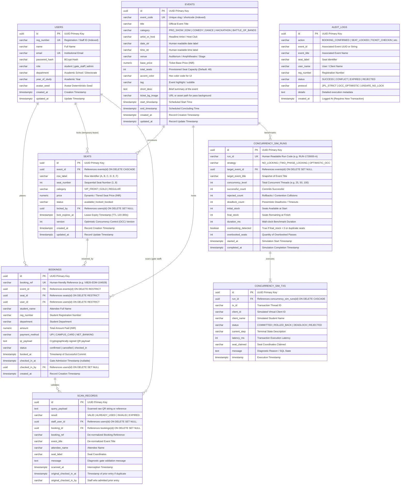

# Vibrance 2026 – Entity-Relationship (ER) Diagram & Relational Schema Specification

## 1. Overview
The Vibrance 2026 Festival Ticketing and Concurrency Simulation Engine is backed by an enterprise-grade PostgreSQL relational database schema designed to demonstrate rigorous database management principles, strict ACID transaction guarantees, Two-Phase Locking (2PL), Optimistic Concurrency Control (OCC), and relational integrity under high concurrency.

---

## 2. Mermaid Entity-Relationship Diagram

---

## 3. Relational Schema Normalization Analysis

### First Normal Form (1NF)
- **Atomic Values**: Every table attribute contains indivisible, scalar values. Seat coordinates are decomposed into `row_label` (VARCHAR) and `seat_number` (INT).
- **No Repeating Groups**: Relational lists (such as seats per event or bookings per user) are represented through foreign keys in separate tables rather than comma-separated arrays or embedded collections.
- **Primary Keys**: Every relation enforces an unambiguous Surrogate Primary Key (`UUID DEFAULT gen_random_uuid()`).

### Second Normal Form (2NF)
- Meets all 1NF requirements.
- **No Partial Dependencies**: In composite candidate keys (e.g., `(event_id, row_label, seat_number)` on `seats`), all non-key attributes (`price`, `category`, `status`, `version`) are fully functionally dependent on the primary key `id`, which uniquely identifies the tuple.

### Third Normal Form (3NF)
- Meets all 2NF requirements.
- **No Transitive Dependencies**: Non-key attributes depend directly and only on the primary key:
  - In `bookings`, `seat_id` references `seats(id)`, and `event_id` references `events(id)`. While `student_name` and `department` are captured at booking time, this intentional point-in-time preservation represents a historical immutable financial audit record rather than a transitive dependency violation.
  - In `scan_records`, event and attendee information are de-normalized specifically to preserve immutable gate audit history even if the underlying booking is subsequently cancelled or mutated.

### Boyce-Codd Normal Form (BCNF)
- Meets all 3NF requirements.
- For every functional dependency $X \rightarrow Y$, $X$ is a superkey:
  - `users`: `id` $\rightarrow$ `{reg_number, name, email, role, department}`
  - `events`: `id` $\rightarrow$ `{event_code, title, category, venue, base_price}`
  - `seats`: `id` $\rightarrow$ `{event_id, row_label, seat_number, status, version}`
  - `bookings`: `id` $\rightarrow$ `{booking_ref, event_id, seat_id, user_id, amount, status}`

---

## 4. Integrity Constraints & Referential Actions

1. **Alternate Candidate Keys (UNIQUE)**:
   - `users.reg_number` (UNIQUE NOT NULL)
   - `users.email` (UNIQUE NOT NULL)
   - `events.event_code` (UNIQUE NOT NULL)
   - `seats(event_id, row_label, seat_number)` (Composite UNIQUE constraint — eliminates physical seat duplication within an auditorium)
   - `bookings.booking_ref` (UNIQUE NOT NULL)

2. **Check Constraints (CHECK)**:
   - `users.role IN ('student', 'gate_staff', 'admin')`
   - `seats.status IN ('available', 'locked', 'booked')`
   - `seats.category IN ('VIP_FRONT', 'GOLD', 'REGULAR')`
   - `seats.seat_number BETWEEN 1 AND 8`
   - `seats.price >= 0`
   - `bookings.status IN ('confirmed', 'cancelled', 'checked_in')`
   - `bookings.payment_method IN ('UPI', 'CAMPUS_CARD', 'NET_BANKING')`
   - `scan_records.result IN ('VALID', 'ALREADY_USED', 'INVALID', 'EXPIRED')`
   - `concurrency_sim_runs.strategy IN ('NO_LOCKING', 'TWO_PHASE_LOCKING', 'OPTIMISTIC_OCC')`

3. **Referential Integrity & Delete Cascades**:
   - `seats` $\rightarrow$ `events`: `ON DELETE CASCADE` (Deleting an event cleans up provisioned inventory)
   - `bookings` $\rightarrow$ `seats`: `ON DELETE RESTRICT` (A reserved seat cannot be dropped while an active financial booking exists)
   - `bookings` $\rightarrow$ `events`: `ON DELETE RESTRICT` (Events with booked passes cannot be accidentally purged)
   - `concurrency_sim_txs` $\rightarrow$ `concurrency_sim_runs`: `ON DELETE CASCADE` (Simulation telemetry is bound to its benchmark run)
